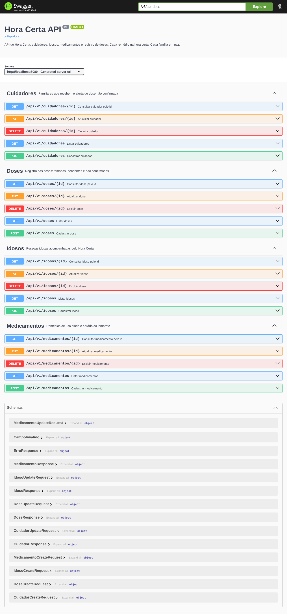

# Hora Certa API

> Cada remédio na hora certa. Cada família em paz.

API REST em **Java 17 + Spring Boot 4** com persistência no **Microsoft SQL Server**, desenvolvida para a
**Global Solution 2026 (2º semestre) – FIAP**, desafio **CitizenTech**, disciplina *Microservice and Web
Engineering & IT Services* (turma 3SIR).

## 👥 Integrantes

| RM | Nome completo |
|----|---------------|
| RM556736 | Enzo Biloschycki Magalhães Cesar |
| RM556586 | Nicolas Varella Barros Padovam |
| RM554540 | Vitor Portela Fantinato |

## 🔗 Links

| Item | Link |
|------|------|
| GitHub | <https://github.com/vitorportelaf/GS-MICROSERVICOS-2-SEMESTRE> |
| API no Azure (Swagger) | `https://hora-certa-554540.purplehill-75e7ba69.brazilsouth.azurecontainerapps.io` |
| Docker Hub | `https://hub.docker.com/r/vitorportelaf/hora-certa` |

---

## 🎯 Objetivo da solução

Idosos com doenças crônicas tomam vários remédios por dia, em horários diferentes, e esquecem doses ou tomam
em dobro. O familiar que cuida, normalmente à distância, só descobre depois. O **Hora Certa** lembra o idoso
na hora do remédio, confirma a dose com o botão **Tomei** e avisa o cuidador quando a dose não é confirmada a
tempo.

Esta API é o back-end da solução. Ela guarda os **cuidadores**, os **idosos** acompanhados, os **medicamentos**
com o horário de cada lembrete e o registro de cada **dose** (pendente, tomada ou não confirmada, e se o
cuidador foi avisado).

## 🗂️ Entidades

```text
cuidadores 1 ──── N idosos 1 ──── N medicamentos 1 ──── N doses
```

| Tabela | Atributos (obrigatórios em **negrito**) | Relacionamento |
|--------|------------------------------------------|----------------|
| `cuidadores` | id, **nome**, **email** (único), **telefone**, parentesco, **data_cadastro** | 1 cuidador acompanha N idosos |
| `idosos` | id, **nome**, **data_nascimento**, telefone, **tolerancia_minutos** (padrão 30), observacoes | N idosos → 1 cuidador |
| `medicamentos` | id, **nome**, **dosagem**, **horario**, **lembrete_por_voz**, **ativo** | N medicamentos → 1 idoso |
| `doses` | id, **data_hora_prevista**, data_hora_confirmacao, **status** (PENDENTE, TOMADA ou NAO_CONFIRMADA), **cuidador_avisado**, observacao | N doses → 1 medicamento |

**Regras de negócio (camada Service):**
- O e-mail do cuidador não pode se repetir.
- Sem tolerância informada, o idoso recebe 30 minutos (o mesmo tempo do app).
- Todo medicamento novo começa ativo; medicamento inativo não recebe novas doses.
- Dose com data de confirmação (botão Tomei) fica **TOMADA**. Marcada como TOMADA sem data, a confirmação é registrada na hora.
- Dose NAO_CONFIRMADA não pode ter data de confirmação, e a confirmação não pode ser mais de 1 hora antes do horário previsto.
- Um registro com dependentes não pode ser excluído (cuidador com idosos, idoso com medicamentos, medicamento com doses).

## 🔌 Endpoints (v1)

Cada entidade tem a sua controller com o CRUD completo. `{recurso}` = `cuidadores`, `idosos`,
`medicamentos` ou `doses`.

| Método | Rota | Sucesso | Erros |
|--------|------|---------|-------|
| POST | `/api/v1/{recurso}` | 201 Created + header `Location` | 400, 404 (vínculo inexistente), 409 |
| GET | `/api/v1/{recurso}` | 200 OK | — |
| GET | `/api/v1/{recurso}/{id}` | 200 OK | 400 (id inválido), 404 |
| PUT | `/api/v1/{recurso}/{id}` | 200 OK | 400, 404, 409 |
| DELETE | `/api/v1/{recurso}/{id}` | 204 No Content | 404, 409 |

Todas as respostas de erro têm o mesmo formato, sem stack trace nem detalhes internos:

```json
{
  "timestamp": "2026-11-16T10:15:30",
  "status": 400,
  "erro": "Bad Request",
  "mensagem": "Dados inválidos. Verifique os campos informados.",
  "caminho": "/api/v1/cuidadores",
  "campos": [ { "campo": "email", "mensagem": "Informe um e-mail válido." } ]
}
```

## 📘 Documentação (Swagger)

A rota raiz **`/`** abre o Swagger UI. A especificação OpenAPI fica em `/v3/api-docs`.



## 🏛️ Arquitetura

```text
src/main/java/br/com/fiap/hora_certa
├── controller/   Recebe as requisições HTTP e chama a Service (nunca o Repository)
├── service/      Regras de negócio e intermediação entre Controller e Repository
├── repository/   Spring Data JPA: acesso ao SQL Server
├── model/        Entidades JPA (cuidadores, idosos, medicamentos, doses)
├── dto/          CreateRequest, UpdateRequest e Response de cada entidade + ErroResponse
├── mapper/       Conversão Model <-> DTO com ModelMapper (um mapper por entidade)
├── exception/    Exceções de negócio e GlobalExceptionHandler (@RestControllerAdvice)
└── config/       Configuração do OpenAPI
```

Fluxo: **Controller → Service → Repository → SQL Server**. As entidades não saem da camada Service: a conversão
para DTO é feita pelos mappers, e os relacionamentos (ex.: `cuidadorId`) são buscados pela Service.

**Tecnologias:** Java 17, Spring Boot 4 (Web MVC, Data JPA, Validation), Microsoft SQL Server (`mssql-jdbc`),
ModelMapper, springdoc-openapi (Swagger UI), JUnit 5 + MockMvc, Docker e GitHub Actions.

---

## 📋 Pré-requisitos

- Java 17 ou superior
- Maven (ou o Maven Wrapper `mvnw`, já incluso)
- SQL Server (ou Docker para subir um)

## ⚙️ Profiles e variáveis de ambiente

| Profile | Uso |
|---------|-----|
| `dev` (padrão) | Desenvolvimento local: SQL Server em `localhost:1433`, banco `horacerta`, usuário `sa` |
| `prd` | Container e Azure: todos os dados de conexão vêm das variáveis abaixo |

| Variável | Descrição | Exemplo |
|---|---|---|
| `SPRING_PROFILES_ACTIVE` | Profile ativo | `dev` ou `prd` |
| `DB_SERVER_URL` | Endereço do SQL Server | `localhost` |
| `DB_SERVER_PORT` | Porta | `1433` |
| `DB_SCHEMA` | Nome do banco | `horacerta` |
| `DB_USER` | Usuário | `sa` |
| `DB_PWD` | Senha (obrigatória, nunca fica no código) | *(sua senha)* |

## 🚀 Execução local

### Opção 1: Docker Compose (SQL Server + API), mais simples

```sh
cp .env.example .env
```

Edite o `.env` e troque a senha do `DB_PWD` (8+ caracteres, com maiúscula, minúscula, número e símbolo). Depois:

```sh
docker compose up --build
```

O compose sobe o SQL Server 2022, cria o banco `horacerta` e inicia a API em <http://localhost:8080>. As
tabelas são criadas automaticamente pelo Hibernate.

### Opção 2: Spring Boot direto, com um SQL Server já rodando

1. Crie o banco no SQL Server:

```sql
CREATE DATABASE horacerta;
```

2. Defina a senha do banco.

Linux / macOS:

```sh
export DB_PWD="<senha-do-sa>"
```

Windows PowerShell:

```powershell
$env:DB_PWD="<senha-do-sa>"
```

3. Execute:

```sh
./mvnw spring-boot:run
```

No Windows:

```powershell
.\mvnw.cmd spring-boot:run
```

A API sobe em <http://localhost:8080>.

## 🐳 Docker

### Criar a imagem

```sh
docker build -t hora-certa:1.0 .
```

### Executar o container

```sh
docker run -p 8080:8080 -e SPRING_PROFILES_ACTIVE=dev -e DB_SERVER_URL=host.docker.internal -e DB_PWD="<senha>" hora-certa:1.0
```

> `host.docker.internal` faz o container acessar o SQL Server que está rodando na sua máquina.

### Imagem no Docker Hub

- **Imagem:** `vitorportelaf/hora-certa`
- **Tags:** `latest`, `v<número da execução>` (ex.: `v3`) e o SHA curto do commit (ex.: `3f2a9c1`)
- **Obter:**

```sh
docker pull vitorportelaf/hora-certa:latest
```

## 🔄 Continuous Delivery (GitHub Actions)

O workflow [`.github/workflows/continuous_delivery.yml`](.github/workflows/continuous_delivery.yml) roda
**automaticamente a cada push na branch `main`** e:

1. Compila a aplicação e roda os testes (`mvn clean verify`).
2. Gera as tags da imagem (`v<run_number>`, SHA do commit e `latest`).
3. Faz login no Docker Hub e constrói e publica a imagem.

Configuração no repositório (*Settings → Secrets and variables → Actions*):

| Tipo | Nome | Valor |
|------|------|-------|
| Variable | `DOCKER_USER` | usuário do Docker Hub |
| Secret | `DOCKER_TOKEN` | Personal Access Token do Docker Hub (Read & Write) |

O histórico das execuções fica na aba **Actions** do GitHub.

## ☁️ Azure

A API roda no **Azure Container Apps** com a imagem do Docker Hub (profile `prd`), conectada a um **Azure SQL
Database**. As variáveis `DB_*` ficam configuradas no Container App, e a senha fica como *secret*. O passo a
passo completo está em [`DEPLOY_AZURE.md`](DEPLOY_AZURE.md).

- **URL:** <https://hora-certa-554540.purplehill-75e7ba69.brazilsouth.azurecontainerapps.io> (abre o Swagger)

## 🧪 Como testar

### Testes automatizados

```sh
./mvnw verify
```

Os testes usam H2 em memória no modo SQL Server e percorrem o CRUD das 4 entidades, conferindo os códigos
201, 200, 204, 400, 404 e 409, além do Swagger na raiz.

### Roteiro manual (Swagger ou Postman)

Base: `http://localhost:8080` (local) ou a URL do Azure.

1. **POST `/api/v1/cuidadores`**

```json
{"nome":"Carlos Souza","email":"carlos@email.com","telefone":"11987654321","parentesco":"Filho"}
```

2. **POST `/api/v1/idosos`**

```json
{"nome":"Maria Souza","dataNascimento":"1948-03-15","telefone":"11912345678","observacoes":"Hipertensa e diabética","cuidadorId":1}
```

3. **POST `/api/v1/medicamentos`**

```json
{"nome":"Losartana","dosagem":"50 mg - 1 comprimido","horario":"08:00","idosoId":1}
```

4. **POST `/api/v1/doses`** (a dose nasce `PENDENTE`)

```json
{"dataHoraPrevista":"2026-11-16T08:00:00","medicamentoId":1}
```

5. **PUT `/api/v1/doses/1`**: o idoso apertou Tomei e a dose vira `TOMADA`

```json
{"dataHoraPrevista":"2026-11-16T08:00:00","dataHoraConfirmacao":"2026-11-16T08:02:00","status":"PENDENTE","cuidadorAvisado":false}
```

6. **GET** nas listas e por id.
7. Erros esperados:
   - GET `/api/v1/idosos/999` → 404
   - POST de cuidador com o mesmo e-mail → 409
   - POST com campos vazios → 400 com a lista de campos
   - DELETE `/api/v1/cuidadores/1` com idoso vinculado → 409
8. **DELETE** na ordem dose → medicamento → idoso → cuidador (204 em cada um).

**Persistência:** reinicie o container (ou a revisão no Azure) e consulte de novo: os dados continuam no SQL
Server.
